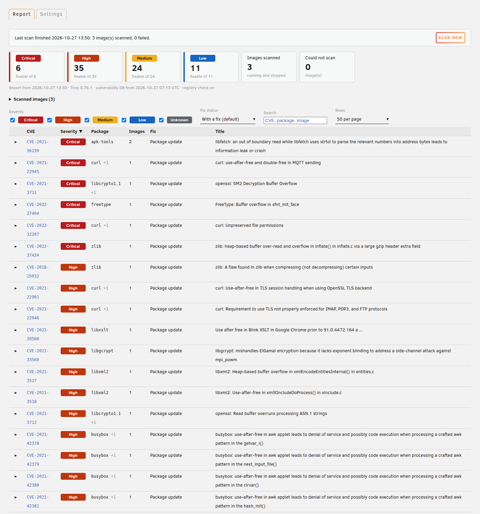
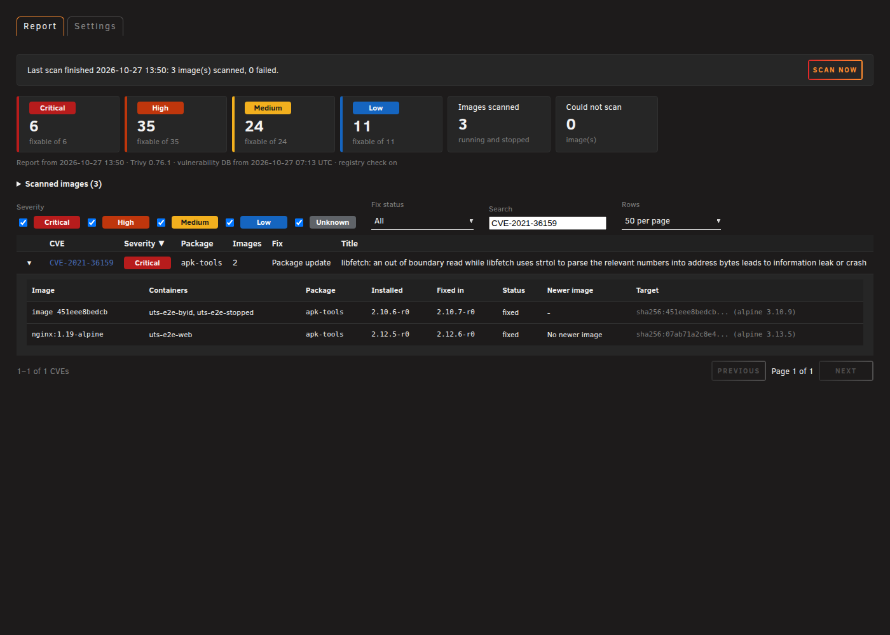
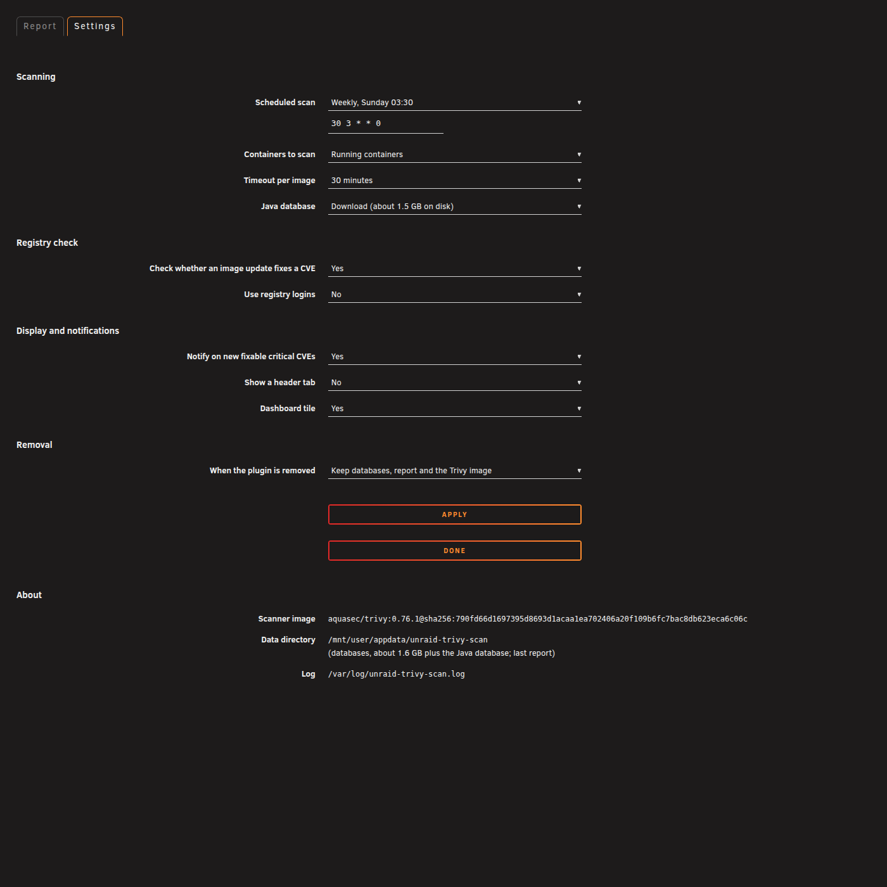
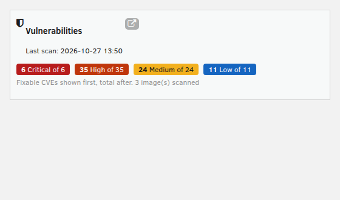

# Trivy Scan for Unraid

An Unraid plugin that scans the images of your Docker containers for known vulnerabilities with
[Trivy](https://github.com/aquasecurity/trivy), and shows the result as one row per CVE: which images and
packages are affected, whether a package update or a newer image fixes it, and which images could not be scanned
and why.

| Report (light theme) | Report, one CVE expanded (dark theme) |
|---|---|
|  |  |

| Settings (dark theme) | Dashboard tile |
|---|---|
|  |  |

The screenshots come from the local render harness (`tests/render/`) with Unraid's own stylesheets, showing a real
scan of three small, deliberately old public images (`nginx:1.19-alpine`, `alpine:3.19.1`, `alpine:3.10`) made by
the end-to-end test. They are not from a real Unraid server; see [Status](#status).

## Install

Plugins, Install Plugin, paste:

```
https://raw.githubusercontent.com/luuvasara/unraid-trivy-scan/main/unraid-trivy-scan.plg
```

Requires Unraid 7.0 or later. Nothing is scanned or downloaded at install time or at boot. Open
**Settings, Trivy Scan** and press **Scan now**, or set a schedule.

The first scan downloads the pinned Trivy image (about 60 MB) and the vulnerability database (about 1.6 GB on
disk), plus about 1.5 GB for the Java database unless you turn that off. They are kept in
`/mnt/user/appdata/unraid-trivy-scan` and reused; Trivy refreshes the database at most about once a day.

## Features

- Scans the images of running containers, or of running and stopped containers. Images are scanned by image ID,
  so a container keeps being scanned correctly after its tag has moved on (the report then says "running older
  image" and that the container needs to be recreated).
- Trivy is pinned by version **and** digest (`aquasec/trivy:0.76.1@sha256:790fd66d…c06c`, the multi-arch index
  digest, identical on Docker Hub and GHCR). A digest cannot be re-pointed, so a later push to a tag never runs on
  your server. The reference is in one place, `TRIVY_IMAGE` in `scripts/trivy-scan`.
- Optional registry check: scans the image each container's tag points to in its registry today and marks the CVEs
  a newer image no longer has ("Fixed in a newer image").
- Per-image timeout. An image that fails (timeout, unsupported content, missing Java database, ...) is listed
  with the reason instead of silently missing from the report.
- Report: one row per CVE, expandable to the affected images, containers, packages, installed and fixed versions;
  filters for severity and fix status (CVEs without any fix are hidden by default, with a count), search, sortable
  columns, paging. Every value is put into the page as text, escaped exactly once.
- A CVE that two images rate differently (for example CRITICAL in one distribution, HIGH in another) is counted
  once, at its highest severity.
- Dashboard tile, optional header tab, Unraid notification when new fixable critical CVEs appear.
- Follows the active Unraid theme (black, white, gray, azure) through the theme's CSS variables.

## How it works

`scripts/trivy-scan` runs every scan. It starts Trivy in short-lived containers, all labelled
`unraid-trivy-scan=1` plus a per-run label, all with `--cap-drop ALL` and `no-new-privileges`:

| Role | Network | Docker socket | Databases | Registry logins |
|---|---|---|---|---|
| Database download | yes | **no** | read-write | no |
| Local image scan | **none** (`--network none`) | yes, needed to read local images | read-only | **never** |
| Registry check (optional) | yes | **no** | read-only | only with "Use registry logins" |

Be clear about what this buys: whoever holds the Docker socket can ask Docker for anything, including a new
container that does have a network. Separating the roles keeps the scanner that holds the socket away from the
internet and away from your registry credentials, and keeps the network-facing containers away from the socket. It
is defence in depth, not a sandbox. Mounting the socket `:ro` would not restrict the Docker API, so the plugin does
not pretend it does.

Results are Trivy's JSON output, merged by `include/aggregate.php` into one report
(`/mnt/user/appdata/unraid-trivy-scan/report/report.json`). Every string from Trivy output is treated as untrusted:
types checked, length capped, control characters removed, advisory links kept only when they are plain `https://`
URLs. The report page draws everything with `textContent`.

Stop (button, upgrade or removal) only touches containers carrying this plugin's label; other Trivy containers on
the server are left alone.

## Settings

Stored on the flash drive in `/boot/config/plugins/unraid-trivy-scan/unraid-trivy-scan.cfg` as plain
`KEY="value"` lines. The file is read as data, never executed, both by the scan script and by the pages. Every
value is checked when the form is saved (the save is refused if anything is invalid) and again whenever it is read
(an invalid value falls back to its default and the settings page says so).

| Key | Values | Default |
|---|---|---|
| `SCHEDULE` | empty (no schedule) or a 5-field cron expression, digits and `* , - /` only, range-checked | empty |
| `SCOPE` | `running`, `all` | `running` |
| `TIMEOUT` | minutes per image, 5 to 240 | `30` |
| `JAVA_DB` | `yes`, `no` | `yes` |
| `REGISTRY_CHECK` | `yes`, `no` | `no` |
| `REGISTRY_AUTH` | `yes`, `no` (mount `/root/.docker/config.json` read-only into the registry-check container) | `no` |
| `NOTIFY` | `yes`, `no` | `yes` |
| `SHOW_TAB` | `yes`, `no` | `no` |
| `DASH_TILE` | `yes`, `no` | `yes` |
| `REMOVE_DATA` | `yes`, `no` (on removal, delete the data directory and the pinned Trivy image) | `no` |

An invalid schedule never reaches cron; with no valid schedule there is no cron entry.

## Lifecycle

- Install and boot: create the runtime directory and write (or remove) the cron entry from the saved settings.
  No scan, no download.
- Upgrade: a running scan is stopped before its script is replaced.
- Removal: a running scan is stopped and the cron entry removed. With "When the plugin is removed" set to delete,
  the data directory (fixed path, only if it is a real directory and not a symlink) and the pinned Trivy image are
  removed too. The settings file on the flash drive is kept.

## Command line

```
/usr/local/emhttp/plugins/unraid-trivy-scan/scripts/trivy-scan start|stop|status|update-db|apply|config|image
```

Log: `/var/log/unraid-trivy-scan.log`.

## Building and testing

```
./build.sh                 # packages/unraid-trivy-scan-<version>-x86_64-1.txz + .md5, fills &md5; in the .plg
tests/run-tests.sh         # lint, unit and render tests (offline)
tests/run-tests.sh --e2e   # plus the end-to-end test against the local Docker
```

Version scheme: `YYYY.MM.DD` plus an optional letter; bump `&version;` in the .plg for every change.

- `tests/lint.sh`: shellcheck (style level, `koalaman/shellcheck:stable` run without network) on all scripts and on
  the .plg's inline blocks with entities resolved; `php -l`; `node --check`; page headers.
- `tests/unit.sh`: cron validation (the bash and PHP validators agree on every case), the settings readers against
  hostile files (command substitution, `; cmd`, newline injection, CRLF, unknown keys), `validate.php` in
  `update.php`'s scope, `apply`, `uninstall` guards, .plg lifecycle rules, and the aggregator on hand-written
  Trivy JSON fixtures (`tests/aggregate-test.php`). A fake `docker` is used, no container is touched.
- `tests/render/render-test.sh`: serves the pages from `php -S 127.0.0.1` through a small router that mimics
  Unraid's page layout, with Unraid's stylesheets (`fetch-webgui.sh`, pinned upstream commit, not stored here).
  Standalone headless Chrome checks that hostile strings in every field show up as text escaped exactly once and
  that nothing executes, tests the action endpoint (method, CSRF token, action list) and takes the screenshots.
- `tests/e2e.sh`: real scans on the local Docker with the pinned image and small old public images: running and
  stopped scope, scan by image ID, registry check with an outdated tag, the container roles (from a logging docker
  shim), a simulated per-image timeout, stop scoped to the plugin's label (an unlabelled container from the same
  Trivy image survives), the lock, `update-db`. It removes the containers and images it added.

## Status

Tested on a Linux workstation only: unit, render and end-to-end tests pass there (Docker 29 with the containerd
image store). **Not yet tested on a real Unraid server.** Still to check there: the webGUI integration (tabs,
Settings form through `update.php`, CSRF handling, the dashboard tile and header tab), `update_cron` and `notify`,
and Unraid's Docker image store.

## Thanks

Thanks to xaero for the original trivy-scan plugin idea on the Unraid forums.

## License

GPL-2.0, see [LICENSE](LICENSE). Trivy is a separate project by Aqua Security under the Apache License 2.0; this
plugin does not include it, it runs the published image.
